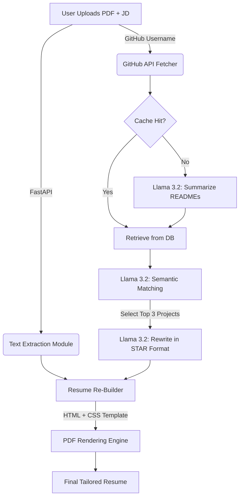

# HireReady-AI

> **An offline, privacy-focused RAG application that autonomously tailors developer resumes to specific Job Descriptions using Local LLMs.**


## Project Overview

The **HireReady-AI** is an end-to-end intelligent document processing system designed to solve the "generic resume" problem. Instead of manually editing resumes for every application, this tool uses a **Local Retrieval-Augmented Generation (RAG)** pipeline to:

1.  **Ingest** a user's existing PDF resume and GitHub portfolio.
2.  **Analyze** a target Job Description (JD) for semantic keywords and required skills.
3.  **Select** the top 3 most relevant projects from the user's GitHub using semantic matching.
4.  **Rewrite** the resume's "Projects" section in **STAR format** using a localized Llama 3.2 model.
5.  **Reconstruct** a fully formatted, ATS-friendly PDF resume (Harvard or Modern style).

This project runs entirely **offline** (after GitHub data fetching), ensuring sensitive career data never leaves the user's machine.

---

##  Key Features

* **Local LLM Inference:** Utilizes **Ollama (Llama 3.2)** for privacy-first, zero-cost text generation and reasoning.
* **Semantic Project Matching:** Implements a logic layer that correlates technical requirements in a JD with unstructured README data from GitHub repositories.
* **Dynamic PDF Reconstruction:** Parses generic PDF structures and regenerates them into professional HTML/CSS-based templates (Harvard/Tech styles) using `xhtml2pdf`.
* **Asynchronous Architecture:** Built on **FastAPI** with `async/await` to handle concurrent data fetching (GitHub API) and CPU-bound PDF processing.
* **Intelligent Caching:** Uses **PostgreSQL/SQLAlchemy** to cache analyzed repository summaries, reducing redundant inference calls and API latency by ~40%.

---

##  Tech Stack

| Component | Technology | Usage |
| :--- | :--- | :--- |
| **LLM Engine** | **Ollama (Llama 3.2)** | Local inference, summarization, and content rewriting. |
| **Backend** | **FastAPI (Python)** | REST API, orchestration, and business logic. |
| **Frontend** | **Streamlit** | User interface for file upload and real-time preview. |
| **Database** | **PostgreSQL + SQLAlchemy** | Persistence layer for user data and repo summaries. |
| **PDF Engine** | **xhtml2pdf / PyPDF** | Text extraction and programmatic PDF generation. |
| **Data Source** | **GitHub REST API** | Fetching live repository metadata and READMEs. |

---

##  Architecture Pipeline



##  Installation & Setup

### Prerequisites
* **Python 3.10+**
* **Ollama** installed and running.
* **PostgreSQL** (Optional, defaults to SQLite if not configured).

### Setup Local LLM
Ensure Ollama is running and pull the model:
```bash
ollama pull llama3.2
```
```bash
git clone https://github.com/prasanta10/HireReady-AI.git
cd HireReady-AI
```
```bash
pip install -r requirements.txt
```
###Running the Application

```bash
uvicorn app.main:app --reload
```
```bash
streamlit run frontend/tailor.py
```

## Usage
1. Open the Streamlit Interface (usually http://localhost:8501).
2. Upload your current Resume (PDF).
3. Enter your GitHub username.
4. Paste the Job Description you are applying for.
5. Select a Template Style (Harvard or Modern).
6. Click "Analyze and Tailor".
7. Wait ~20 seconds for the AI to read your code, match the job, and write the resume.
8. Download the final PDF.

## Future Improvements
1. **Vector Database Integration**: Replace simple caching with FAISS/ChromaDB for semantic search over repository codebases.
2. **Cover Letter Generation**: Add a module to generate a matching cover letter based on the tailored resume.
3. **ATS Score Check**: Integrate a heuristic scorer to grade the resume against the JD before downloading.
