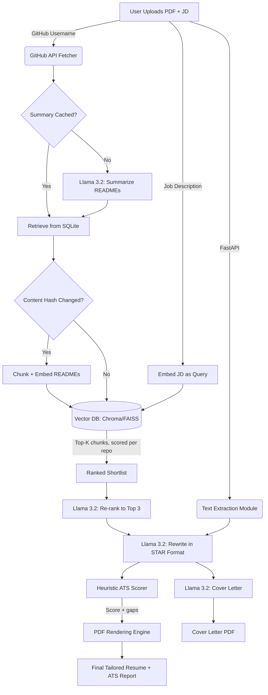

# HireReady-AI

> **An offline, privacy-focused RAG application that autonomously tailors developer resumes to specific Job Descriptions using Local LLMs.**


## Project Overview

The **HireReady-AI** is an end-to-end intelligent document processing system designed to solve the "generic resume" problem. Instead of manually editing resumes for every application, this tool uses a **Local Retrieval-Augmented Generation (RAG)** pipeline to:

1.  **Ingest** a user's existing PDF resume and GitHub portfolio.
2.  **Index** every repository README as embeddings in a local **vector database** (ChromaDB or FAISS).
3.  **Analyze** a target Job Description (JD) for semantic keywords and required skills.
4.  **Retrieve** the most relevant projects by vector similarity, then let the LLM re-rank the shortlist.
5.  **Rewrite** the resume's "Projects" section in **STAR format** using a localized Llama 3.2 model.
6.  **Score** the result against the JD with a heuristic **ATS grader** before you download it.
7.  **Generate** a matching **cover letter** from the tailored resume and the selected projects.
8.  **Reconstruct** a fully formatted, ATS-friendly PDF resume.

This project runs entirely **offline** (after GitHub data fetching), ensuring sensitive career data never leaves the user's machine.

---

##  Key Features

* **Local LLM Inference:** Utilizes **Ollama (Llama 3.2)** for privacy-first, zero-cost text generation and reasoning.
* **Vector Search over Repositories:** READMEs are chunked, embedded (`nomic-embed-text`) and stored in a persistent **vector database**. Project selection is retrieval-driven, not a flat cache lookup — the LLM only re-ranks an already relevant shortlist, so a model hiccup degrades to semantic order instead of an arbitrary slice.
* **Pluggable Vector Backend:** **ChromaDB** by default, **FAISS** on request, and a dependency-free NumPy index as the last resort — all behind one interface, chosen with `VECTOR_BACKEND`.
* **Heuristic ATS Scoring:** Grades the resume against the JD on six weighted checks (keywords, hard skills, section structure, contact details, quantified impact, formatting) and reports the before/after delta plus concrete fixes. No LLM involved, so the score is instant, deterministic and explainable.
* **Cover Letter Generation:** Produces a matching, project-specific cover letter from the tailored resume, downloadable as Markdown or PDF.
* **Asynchronous Architecture:** Built on **FastAPI** with `async/await`; blocking LLM, embedding and PDF work is dispatched to worker threads so the event loop stays responsive.
* **Two-Layer Caching:** SQLite/SQLAlchemy caches LLM summaries while a content hash keeps the vector index in sync — unchanged repositories are never re-summarised or re-embedded.

---

##  Tech Stack

| Component | Technology | Usage |
| :--- | :--- | :--- |
| **LLM Engine** | **Ollama (Llama 3.2)** | Local inference, summarization, and content rewriting. |
| **Backend** | **FastAPI (Python)** | REST API, orchestration, and business logic. |
| **Frontend** | **Streamlit** | User interface for file upload and real-time preview. |
| **Database** | **SQLite + SQLAlchemy/SQLModel** | Persistence layer for user data and repo summaries. |
| **Vector Store** | **ChromaDB / FAISS / NumPy** | Semantic index over repository content (`VECTOR_BACKEND`). |
| **Embeddings** | **Ollama (nomic-embed-text)** | Local vectors for JD-to-repository matching. |
| **ATS Scoring** | **Pure Python heuristics** | Deterministic keyword, structure and impact grading. |
| **PDF Engine** | **xhtml2pdf / PyPDF** | Text extraction and programmatic PDF generation. |
| **Data Source** | **GitHub REST API** | Fetching live repository metadata and READMEs. |

---

##  Architecture Pipeline



##  Installation & Setup

### Prerequisites
* **Python 3.10+**
* **Ollama** installed and running.
* **PostgreSQL** (Optional, defaults to SQLite if not configured).

### Setup Local LLM
Ensure Ollama is running and pull both the chat model and the embedding model:
```bash
ollama pull llama3.2
ollama pull nomic-embed-text
```
> Without `nomic-embed-text` the app still runs: it falls back to a hashed bag-of-words
> embedder, which keeps retrieval working offline at lower semantic quality.
```bash
git clone https://github.com/prasanta10/HireReady-AI.git
cd HireReady-AI
```
```bash
pip install -r requirements.txt
```

### Configuration (optional)
Every setting has a working default; override any of them in a `.env` file:

| Variable | Default | Purpose |
| :--- | :--- | :--- |
| `GITHUB_TOKEN` | *(none)* | Raises the GitHub API rate limit. |
| `LLM_MODEL` | `llama3.2` | Ollama chat model. |
| `EMBED_MODEL` | `nomic-embed-text` | Ollama embedding model. |
| `VECTOR_BACKEND` | `auto` | `auto`, `chroma`, `faiss` or `numpy`. |
| `VECTOR_STORE_DIR` | `./vector_store` | Where the index is persisted. |
| `MAX_REPOS` | `10` | Repositories summarised per request. |
| `SHORTLIST_SIZE` | `6` | Repositories retrieved before LLM re-ranking. |
| `FINAL_PROJECT_COUNT` | `3` | Projects written into the resume. |

To use FAISS instead of ChromaDB:
```bash
pip install faiss-cpu
VECTOR_BACKEND=faiss uvicorn app.main:app --reload
```

### Running the Application

```bash
uvicorn app.main:app --reload
```
```bash
streamlit run frontend/tailor.py
```

## Usage
1. Open the Streamlit Interface (usually http://localhost:8501).
2. Upload your current Resume (PDF).
3. Enter your GitHub username.
4. Paste the Job Description you are applying for.
5. Click "Analyze and Tailor".
6. Wait ~20 seconds for the AI to read your code, match the job, and write the resume.
7. Review the results in four tabs:
   * **PDF Preview** — the rebuilt resume, with its ATS score shown next to the download button.
   * **Markdown Source** — the raw Markdown, downloadable as `.md`.
   * **ATS Score** — before/after scores, per-check breakdown, matched vs. missing keywords, and fixes.
   * **Cover Letter** — enter the company and role, generate the letter, download it as Markdown or PDF.
8. Download the final PDF.

##  ATS Scoring Model

The scorer is heuristic and LLM-free, so it is instant, deterministic and fully explainable.
Six weighted checks add up to 100:

| Check | Weight | What it measures |
| :--- | :--- | :--- |
| Keyword Match | 40 | Frequency-weighted JD keywords present in the resume (aliases included: `k8s` ↔ `kubernetes`, `ml` ↔ `machine learning`). |
| Skills Coverage | 20 | Hard/technical skills the JD explicitly requires. |
| Section Structure | 15 | Skills, Experience, Education and Projects headings a parser expects. |
| Contact Info | 10 | Email, phone number and a professional profile link. |
| Impact & Metrics | 10 | Bullet volume, action-verb openers and quantified results. |
| ATS Formatting | 5 | Length, bullet hygiene, no first-person voice, no parser-hostile tables or emoji. |

Scores map to grades A (≥85), B (≥70), C (≥55), D (≥40), F below that, and every deduction
comes back as a concrete suggestion.

##  API Reference

| Method | Endpoint | Purpose |
| :--- | :--- | :--- |
| `GET` | `/` | Health check. |
| `GET` | `/index/stats?username=` | Vector backend, embedder and chunk counts. |
| `POST` | `/resume/tailor` | Full pipeline (multipart: `file`, `username`, `job_description`). Returns the tailored Markdown, the PDF, the matched projects and both ATS reports. |
| `POST` | `/resume/ats-score` | Grade any resume against a JD (JSON: `resume_text`, `job_description`, `is_markdown`). |
| `POST` | `/resume/cover-letter` | Generate a cover letter (JSON: `resume_text`, `job_description`, `company_name`, `role_title`, `hiring_manager`, `tone`, `projects`). |

```bash
curl -X POST http://127.0.0.1:8000/resume/ats-score \
  -H "Content-Type: application/json" \
  -d '{"resume_text": "# Jane Dev\n...", "job_description": "Backend engineer, Python, Docker..."}'
```

## Future Improvements
1. **Code-Level Indexing**: Embed source files and commit history, not just READMEs, for finer-grained retrieval.
2. **Multi-Template Rendering**: Restore selectable Harvard/Modern PDF themes on top of the Markdown pipeline.
3. **Application Tracker**: Persist each tailored resume, cover letter and ATS score per job application.
